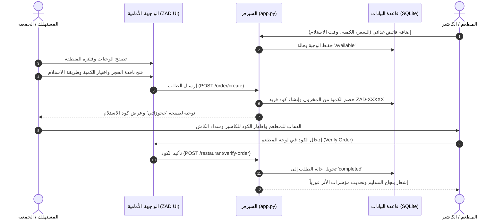

# 🎓 الدليل الشامل لشرح الكود البرمجي لمشروع منصة زَادْ (ZAD)
### خاص بفريق عمل مشروع التخرج — نظم معلومات إدارية (MIS) 2026
> **الهدف من هذا الدليل:** مرجع كامل وخاص بالطلبة لفهم بنية المشروع سطرًا بسطر، ومعرفة دور كل ملف ودالة، والاستعداد التام لأسئلة المناقشة ولجنة التحكيم.

---

## 📑 فهرس محتويات الدليل
1. [نظرة عامة على معمارية المشروع (System Architecture)](#1-نظرة-عامة-على-معمارية-المشروع)
2. [هيكل الملفات والمجلدات وتوزيع الأدوار](#2-هيكل-الملفات-والمجلدات)
3. [شرح قاعدة البيانات (Database Schema & Relations)](#3-شرح-قاعدة-البيانات)
4. [شرح كود الباك إند بالتفصيل (app.py) دالة بدالة](#4-شرح-كود-الباك-إند-apppy)
5. [شرح كود الواجهة الأمامية والتفاعل (JavaScript & CSS)](#5-شرح-كود-الواجهة-الأمامية)
6. [دورة حياة الطلب من البداية للنهاية (End-to-End Data Flow)](#6-دورة-حياة-الطلب-من-البداية-للنهاية)
7. [بنك الأسئلة التقنية المتوقعة من دكتور المادة وكيف تجيب عليها](#7-بنك-أسئلة-المناقشة-المتوقعة)

---

## 1. نظرة عامة على معمارية المشروع

مشروع منصة **زَادْ (ZAD)** مبني وفق نمط المعمارية الشهير عالميّاً **MVC (Model - View - Controller)** عبر إطار عمل **Flask (Python)**:

* **Model (قاعدة البيانات):** يتمثل في ملف `database.db` وجداول SQLite الثلاثة (`users`, `meals`, `orders`).
* **View (الواجهات):** ملفات قوالب Jinja2 في مجلد `templates/`، والمصممة بأسلوب متقدم بنظام التوريث من `base.html`.
* **Controller (المتحكم والمنطق):** ملف `app.py`، الذي يحتوي على المسارات (Routes)، الصلاحيات، معالجة النماذج، التحقق الأمني، وحسابات نظم دعم القرار (DSS).

---

## 2. هيكل الملفات والمجلدات

```text
zad_food_rescue/
│
├── app.py                     # الملف الرئيسي للسيرفر والمنطق البرمجي (Backend Controller)
├── database.db                # قاعدة البيانات العلائقية (SQLite Database)
│
├── static/                    # الملفات الثابتة (Static Assets)
│   ├── css/
│   │   └── style.css          # ملف التنسيقات ونظام الألوان المتطور (Emerald & Amber Palette)
│   └── js/
│       └── main.js            # محرك التفاعل (GSAP, Lenis, Toasts, Countdown, Tooltips)
│
└── templates/                 # قوالب HTML (Jinja2 Templates)
    ├── base.html              # القالب الأساسي الحاوي للنافبار، الفوتر، والمكتبات المشتركة
    ├── index.html             # الصفحة الرئيسية، الفلاتر، شبكة الوجبات، ومودال الحجز
    ├── login.html             # صفحة الدخول مع زر إظهار الباسورد 👁️
    ├── register.html          # صفحة التسجيل وتحديد الدور (Role) مع شرط الـ 8 خانات
    ├── my_orders.html         # صفحة حجوزات المستهلك / الجمعية وكود الاستلام
    ├── restaurant_dashboard.html # لوحة المطعم (إضافة، تعديل، حذف، وتحقق من الكود)
    ├── charity_dashboard.html    # لوحة الجمعيات الخيرية وشهادة الأثر القابلة للطباعة 🏆
    └── admin_dashboard.html   # لوحة الإدارة، الرسوم البيانية، ونظم دعم القرار (MIS DSS)
```

---

## 3. شرح قاعدة البيانات (Database Schema)

قاعدة البيانات تحتوي على 3 جداول مترابطة بعلاقات علائقية (Relational Constraints):

### أ) جدول المستخدمين (`users`):
* `id`: رقم تسلسلي فريد تلقائي (Primary Key).
* `username`: اسم المستخدم الفريد (Unique) المستخدم في تسجيل الدخول.
* `password_hash`: التشفير الآمن لكلمة المرور باستخدام خوارزمية **Scrypt** (لا يتم حفظ الباسورد نصياً أبداً لحماية الخصوصية).
* `full_name`: الاسم الكامل أو اسم المنشأة / الجمعية.
* `role`: دور المستخدم في النظام (`customer` مشتري، `restaurant` منشأة غذائية، `charity` جمعية، `admin` مدير).
* `phone`: رقم الهاتف للتواصل في حالات التوصيل.
* `address`: العنوان المعتمد للمنشأة أو العميل (مهم للفلترة الجغرافية).
* `created_at`: تاريخ ووقت إنشاء الحساب.

### ب) جدول الوجبات والفوائض (`meals`):
* `id`: المعرف الفريد للوجبة (Primary Key).
* `restaurant_id`: رقم المطعم صاحب العرض (Foreign Key يشير إلى `users.id`).
* `title`: اسم الوجبة أو العرض (مثل: بوكس مخبوزات طازجة).
* `description`: وصف المحتويات وملاحظات التعبئة.
* `category`: تصنيف الطعام (مخبوزات، وجبات رئيسية، حلويات، خضار وفواكه، أخرى).
* `original_price`: السعر الأصلي قبل التخفيض (بالجنيه).
* `discounted_price`: السعر المخفض في عروض التوفير (أو 0 في حالة التبرع).
* `quantity`: رصيد الكمية المتبقية المتاحة للحجز لحظيّاً.
* `pickup_time`: نافذة الاستلام المحددة (مثل: اليوم من 9م إلى 11م).
* `is_charity`: نوع العرض (0 = بيع مخفض للمستهلكين، 1 = تبرع مجاني حصري للجمعيات).
* `status`: حالة المخزون (`available` متاح، `sold_out` نفد).

### ج) جدول الطلبات والحجوزات (`orders`):
* `id`: رقم الطلب (Primary Key).
* `order_code`: كود فريد فريد عشوائي مكون من 8 خانات يبدأ بـ `ZAD-` (مثل: `ZAD-90BBY`).
* `meal_id`: رقم الوجبة المحجوزة (Foreign Key يشير إلى `meals.id`).
* `user_id`: رقم المستهلك أو الجمعية الحاجزة (Foreign Key يشير إلى `users.id`).
* `quantity`: عدد الوجبات المحجوزة في هذا الطلب (يدعم حجز 1، 2، 3 وجبات... إلخ).
* `total_price`: المبلغ الإجمالي المطلوب سداده نقداً كاش (شاملاً رسوم التوصيل إن وجدت).
* `status`: حالة الطلب (`pending` في انتظار الاستلام، `completed` تم التسليم، `cancelled` تم الإلغاء).
* `delivery_type`: طريقة الاستلام (`pickup` استلام ذاتي من المحل، أو `delivery` توصيل دليفري).
* `delivery_address`: عنوان التوصيل بالتفصيل (في حال اختيار دليفري).
* `delivery_fee`: رسوم التوصيل (20 ج.م في حال طلب التوصيل المنزلي للوجبات المخفضة، و 0 للاستلام الذاتي والتبرع).

---

## 4. شرح كود الباك إند (app.py) دالة بدالة

### 1) الاتصال بقاعدة البيانات (`get_db` & `init_db`):
* نستخدم `sqlite3.connect(DB_PATH)`.
* نضع `conn.row_factory = sqlite3.Row` حتى نستطيع التعامل مع الحقول بأسماء الأعمدة (مثل `meal["title"]`) بدلاً من أرقام المؤشرات.
* `init_db()`: تنشئ الجداول تلقائياً لو لم تكن موجودة، وتضيف أعمدة التوصيل والكميات بدقة.

### 2) التحقق من الصلاحيات والتحكم في الوصول (RBAC - Role Based Access Control):
* دالة `@login_required`: مزخرف (Decorator) يتأكد أن مفتاح `user_id` موجود في `session`؛ وإذا لم يكن موجوداً يوجهه لصفحة `/login`.
* دالة `@role_required(*allowed_roles)`: تتأكد أن دور المستخدم الحالي (`session["role"]`) من ضمن الأدوار المسموح لها فقط بدخول هذه الصفحة (مثلاً: حماية لوحة الأدمن وحصرها على `admin` فقط).

### 3) معادلات الأثر البيئي (`calculate_environmental_impact`):
تعتمد على معايير بيئية عالمية ترتبط بوزن الطعام المهدر:
```python
def calculate_environmental_impact(rescued_meals_count):
    avg_kg_per_meal = 0.45       # متوسط وزن الوجبة 450 جرام
    co2_per_kg_food = 2.5        # كل 1 كجم طعام منقذ يجنبنا 2.5 كجم من مكافئ الكربون CO2e
    water_liters_per_kg = 1000   # كل 1 كجم طعام يوفر 1000 لتر من البصمة المائية الافتراضية
    ...
```

### 4) حماية كلمات المرور وشرط القوة:
* في دالة `register()`:
  - التحقق من طول الباسورد: `if len(password) < 8:` يرفض التسجيل فوراً ويظهر رسالة تحذيرية للمستخدم.
  - التشفير: `generate_password_hash(password)` يحول الباسورد إلى Hash مشفر لا يمكن فكه حتى لو تم تسريب قاعدة البيانات.
* في دالة `login()`:
  - التحقق: `check_password_hash(user["password_hash"], password)` يقارن الباسورد المدخل بالـ Hash المشفر بأمان.

### 5) معالجة حجز الطلبات والكميات المتعددة (`create_order`):
تعتبر هذه الدالة قلب منطق العمليات في المنصة (Core Business Logic):
1. **التحقق من الدور الصارم:** تمنع المطاعم من حجز وجبات لنفسها أو لمطاعم أخرى؛ الحجز متاح لحسابات المشترين والجمعيات فقط.
2. **الحصرية الخيرية:** تمنع المستهلك العادي من حجز وجبات التبرع الخيري (حصرها على الجمعيات فقط).
3. **استقبال وتطهير الكمية:**
   ```python
   raw_qty = str(request.form.get("quantity", "1")).strip()
   arabic_digits = str.maketrans("٠١٢٣٤٥٦٧٨٩", "0123456789")
   raw_qty = raw_qty.translate(arabic_digits) # يدعم أرقام الموبايل العربية
   requested_qty = int(raw_qty)
   ```
4. **التحقق من كفاية المخزون:** `if meal["quantity"] < requested_qty: flash(...)`.
5. **توليد كود الحجز:** توليد كود فريد مكون من حروف وأرقام عشوائية بصيغة `ZAD-XXXXX`.
6. **حساب التكلفة:** ضرب سعر الوجبة في الكمية المطلوبة + إضافة رسوم التوصيل (20 ج.م) إذا اختار العميل خيار التوصيل.
7. **خصم المخزون الحقيقي:**
   ```python
   new_quantity = meal["quantity"] - requested_qty
   new_status = 'sold_out' if new_quantity == 0 else 'available'
   cursor.execute("UPDATE meals SET quantity = ?, status = ? WHERE id = ?", ...)
   ```

### 6) التحقق من كود الاستلام للمطعم (`verify_order`):
* يدخل الكاشير الكود في الصندوق أو يمسحه.
* يتحقق النظام أن الوجبة تخص نفس المطعم وأن الطلب ما زال معلقاً (`pending`).
* يحول حالة الطلب فوراً إلى `completed`، وتنعكس مباشرة على مؤشرات إنقاذ الطعام والأثر البيئي.

### 7) ميزة الإلغاء وإعادة المخزون التلقائي (`cancel_order`):
* إذا تعذر على العميل أو الجمعية الحضور، يمكنهم الضغط على "إلغاء الحجز".
* يقوم النظام بتحويل حالة الطلب إلى `cancelled` ويقوم فوراً بإعادة الكمية المحجوزة إلى رصيد الوجبة المتاح للمطعم (`UPDATE meals SET quantity = quantity + order_qty`).

### 8) لوحة الجمعيات الخيرية وشهادة الأثر (`charity_dashboard`):
* تحسب عدد الوجبات الإغاثية المستلمة، وعدد الأسر المستفيدة، والقيمة السوقية للطعام المنقذ.
* تتيح طباعة شهادة الأثر وتفعيل الـ `@media print`.

### 9) لوحة تحكم الأدمن ونظم دعم القرار (`admin_dashboard`):
* تحسب مؤشرات كفاءة سلاسل الإمداد ومعدل الإنجاز (`fulfillment_rate`).
* تحسب الصنف الأكثر تسجيلاً للهدر الغذائي (`highest_waste_category`) لتقديم التوصيات التنفيذية للإدارة.

---

## 5. شرح كود الواجهة الأمامية والتفاعل (UI/UX)

### أ) ملف `static/js/main.js`:
* **Lenis Smooth Scroll:** مكتبة حديثة تمنح التمرير في الموقع نعومة وسلاسة فائقة تضاهي المواقع العالمية.
* **GSAP Animation Suite:** تحريك عناصر البانر الرئيسي تدريجياً، وظهور كروت الوجبات المتتابع (Staggered Entrance)، وتصاعد الأرقام الحسابية في عدادات الأثر (CountUp Effect).
* **Surplus Expiry Countdown Timers:** عدادات تنازلية رقمية تحسب الوقت المتبقي لكل وجبة حتى موعد الإغلاق، وتعتمد على `localStorage` لضمان عدم إعادة تصفير الوقت عند عمل Refresh.
* **Modern Floating Toasts:** نظام إشعارات عائم بديل لتنبيهات البوتستراب التقليدية، يظهر في زاوية الشاشة ويختفي بنعومة بعد 4.5 ثانية.
* **Password Toggle 👁️:** مراقبة زر العين وتبديل حقل كلمة المرور بين `type="password"` و `type="text"`.
* **Quick Copy:** نسخ كود الاستلام فور الضغط عليه مع إشعار عائم.

### ب) ملف `static/css/style.css`:
* **لوحة ألوان مستوحاة من الاستدامة:**
  - درجات الزمرد الأخضر الغني (`#059669`, `#047857`, `#022c22`) لتعكس الطبيعة والزراعة والحياة.
  - درجات الكهرمان والذهب (`#f59e0b`, `#d97706`) للإشعارات وتنبيهات الخصم والتبرعات.
  - خلفيات نظيفة جداً (`#f8fafc`) لراحة العين.
* **Glassmorphism:** تأثير الزجاج الضبابي الشفاف في شريط التنقل (Navbar) والبانر الرئيسي لإعطاء عمق بصري راقٍ.
* **Micro-interactions:** تأثير رفع الكارت (`translateY(-8px)`) مع ظل ناعم عند مرور الماوس فوق أي وجبة.

---

## 6. دورة حياة الطلب والتبرع من البداية للنهاية



---

## 7. بنك أسئلة المناقشة المتوقعة من دكتور المادة وكيف تجيب عليها

### س1: ما الذي يربط هذا المشروع بمجال نظم المعلومات الإدارية (MIS) تحديداً؟
> **الإجابة النموذجية:**
> "مشروع زاد ليس مجرد موقع تجارة إلكترونية، بل هو **نظام معلومات إداري متكامل لإدارة سلاسل الإمداد الغذائي (Food Supply Chain Management)**. النظام يعمل كـ **نظام دعم قرار (DSS)** يساعد الإدارة وأصحاب المنشآت على رصد الفوائض، التنبؤ بأوقات وأصناف الهدر (مثل المخبوزات)، ويوفر لوحة مؤشرات قياس أداء (KPIs) تجمع بين الجدوى الاقتصادية، المسؤولية المجتمعية (CSR)، وتحقيق أهداف التنمية المستدامة (SDGs)."

### س2: كيف يضمن النظام عدم حدوث هدر أو بيع وجبات غير متوفرة (Overbooking / Concurrency)؟
> **الإجابة النموذجية:**
> "يقوم النظام بإجراء تحقق صارم على مستوى السيرفر وقاعدة البيانات؛ بمجرد أن يطلب العميل كمية معينة، يتم التأكد أن `requested_qty <= meal.quantity`. وإذا تمت العملية بنجاح، يتم خصم الكمية فوراً في نفس المعاملة (Database Transaction)، ولو وصلت الكمية إلى صفر تتحول حالة الوجبة فوراً إلى `sold_out` وتختفي أزرار الحجز."

### س3: كيف حميتم كلمات المرور والبيانات الحساسة في النظام؟
> **الإجابة النموذجية:**
> "نطبق معايير الأمان الموصى بها في OWASP؛ لا نقوم بتخزين كلمات المرور كنصوص صريحة نهائياً، بل نستخدم خوارزمية التشفير التكيفية **Scrypt** عبر `generate_password_hash` مع تشفير أحادي الاتجاه (One-Way Hashing Salted). بالإضافة إلى التحقق من قوة كلمة المرور بحيث لا تقل عن 8 خانات، واستخدام آلية التحكم بالوصول المبنية على الأدوار (Role-Based Access Control - RBAC) لعزل صلاحيات كل مستخدم."

### س4: ماذا يحدث لو حجز العميل وجبة ولم يحضر لاستلامها في الموعد؟
> **الإجابة النموذجية:**
> "النظام مزود بمسار إلغاء مرن (Cancellation & Restocking Flow). إذا ألغى العميل الحجز، يقوم النظام تلقائياً بإعادة الكمية المحجوزة فوراً إلى مخزون المطعم المتاح ليتيح الفرصة لمستهلك آخر أو جمعية خيرية لإنقاذها قبل موعد إغلاق المطعم."

### س5: كيف تم احتساب أرقام توفير الكربون والمياه في لوحة الإدارة؟
> **الإجابة النموذجية:**
> "بناءً على دراسات منظمة الأغذية والزراعة (FAO) وبرنامج الأمم المتحدة للبيئة (UNEP)؛ كل وجبة منقذة تزن في المتوسط 450 جراماً، وكل 1 كجم من نفايات الطعام المتجنبة يمنع انبعاث 2.5 كجم من مكافئ غاز ثاني أكسيد الكربون ($CO_2e$)، ويوفر 1000 لتر من البصمة المائية الافتراضية المستهلكة في الزراعة والإنتاج الحيواني."

---
*تم إعداد هذا الدليل ليكون سندكم القوي في المذاكرة والمناقشة، وبالتوفيق والدرجات العليا دائماً!*
